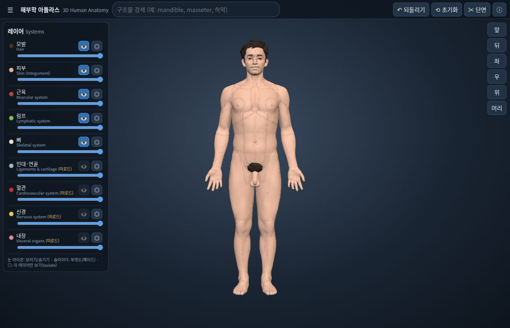
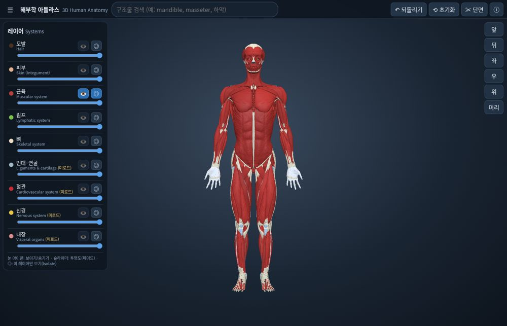
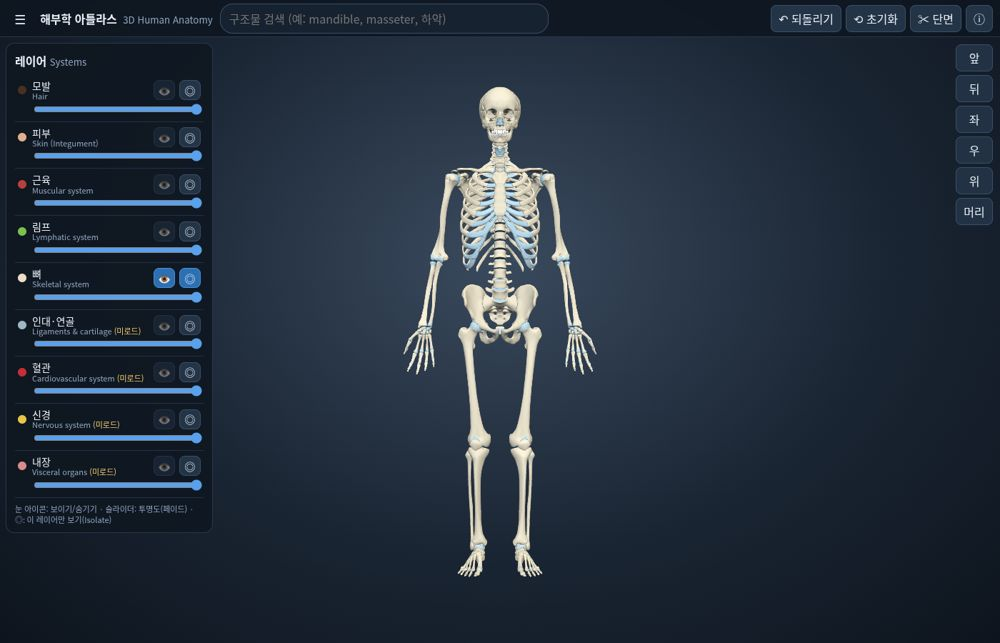
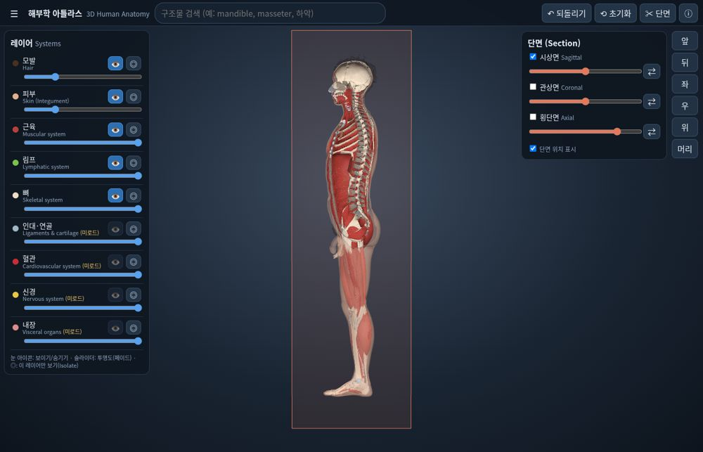
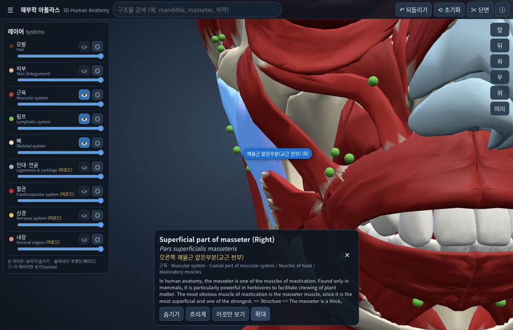
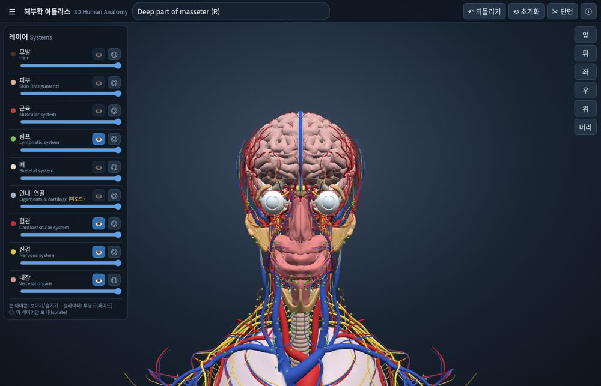

# 3D 인체 해부학 아틀라스 (오픈데이터 웹 버전)

Visible Body의 **Human Anatomy Atlas** 앱 사용 방식(레이어별 보기, 페이드아웃, 단독 보기, 구조물 선택, 단면)을 참고해 만든 **웹 브라우저용 3D 해부학 뷰어**입니다.
설치 없이 브라우저에서 바로 쓸 수 있고, 내려받아 내 컴퓨터에서 오프라인으로도 실행할 수 있습니다.

> Visible Body와 관계없는 비공식 프로젝트입니다. 3D 모델은 공개 라이선스 데이터(Z-Anatomy / BodyParts3D)를 변환해 사용했습니다. 교육·참고용입니다.

| 전체 레이어 | 근육만 | 뼈만 |
|---|---|---|
|  |  |  |
| **시상면 단면** | **구조물 선택(교근)** | **혈관·신경·림프** |
|  |  |  |

## 바로 실행 (온라인)

👉 **https://dentfixa.github.io/anatomy-atlas/**

PC·태블릿·스마트폰 브라우저(Chrome, Edge, Safari)에서 열립니다. 처음 열 때 약 8MB를 내려받습니다(혈관·신경·내장은 켤 때 추가로 내려받음).

## 내려받아 내 컴퓨터에서 실행

1. 이 페이지 위쪽의 초록색 **Code** 버튼 → **Download ZIP**을 눌러 받은 뒤 압축을 풉니다.
2. 운영체제에 맞는 파일을 더블클릭합니다.
   - **Windows**: `start-windows.bat` (설치 필요 없음. PowerShell로 작은 로컬 서버를 띄우고 브라우저가 자동으로 열립니다. 창을 닫으면 종료)
   - **macOS / Linux**: `start-mac-linux.command` (Python 3 필요. 맥에서 처음 실행할 때 "확인되지 않은 개발자" 경고가 나오면 마우스 오른쪽 클릭 → 열기)
   - 또는 터미널에서 이 폴더로 이동한 뒤 `python3 -m http.server 8642` 를 실행하고 http://localhost:8642 를 엽니다.
3. 브라우저에서 `http://localhost:8642/` 가 열리면 됩니다.

> `index.html`을 그냥 더블클릭(`file://`)하면 브라우저 보안 정책 때문에 3D 모델이 로드되지 않습니다. 위의 실행 파일을 쓰세요.

## 기능

| 기능 | 설명 |
|---|---|
| 레이어 | 모발 · 피부 · 근육 · 림프 · 뼈 + 인대·연골 · 혈관 · 신경(뇌 포함) · 내장 (9개 계통) |
| 보이기/숨기기 | 레이어마다 👁 버튼 |
| 페이드아웃 | 레이어마다 투명도 슬라이더 (예: 피부를 반투명하게 → 속 근육 보기) |
| 단독 보기(Isolate) | ◎ 버튼 → 그 레이어만 표시 (근육만, 뼈만 등) |
| 구조물 선택 | 클릭/탭 → 파란색 강조 + 이름표, 아래 카드에 영어 이름 · 라틴어 · (일부) 한글 · 소속 그룹 · 설명 |
| 선택 구조물 조작 | 숨기기 · 흐리게 · 이것만 보기 · 확대 |
| 되돌리기 / 초기화 | ↶ 되돌리기(여러 단계), ⟲ 초기화 |
| 단면 | ✂ 시상면 · 관상면 · 횡단면, 슬라이더로 위치 조절, ⇄ 방향 뒤집기 |
| 시점 | 앞 · 뒤 · 좌 · 우 · 위 · 머리 프리셋, 드래그 회전 · 휠/핀치 확대 · 우클릭/두 손가락 이동 |
| 검색 | 영어·라틴어·일부 한글 이름으로 3,000여 개 구조물 검색 → 해당 레이어 자동 로드 후 선택·확대 |
| 모바일 | 터치 회전/확대, ☰ 버튼으로 레이어 패널 열고 닫기 |

## 데이터 출처·라이선스

- **Z-Anatomy** – The open source atlas of anatomy – **CC BY-SA 4.0**
  https://www.z-anatomy.com/ · 사용한 파일: https://github.com/LluisV/Z-Anatomy-Sample (`Assets/Models/1.0 Models/*.fbx`)
- **BodyParts3D** – © The Database Center for Life Science – **CC BY-SA 2.1 Japan** (현재 배포처 표기는 CC BY 4.0)
  https://dbarchive.biosciencedbc.jp/en/bodyparts3d/ – Z-Anatomy 모델의 기반 데이터입니다.
- Z-Anatomy 원본에 포함된 추가 모델: "Brainder", "White matter" (University of Washington), "Cranial Nerves and Foramina" (University of Dundee, CAHID, CC BY 4.0).
  원본 안내문(`models/Z-Anatomy-notice.txt`)에 **비상업(NC) 라이선스**로 표기된 "Anatomy of the Inner Ear"(내이)와 "Kidney"(신장 세부) 모델에 해당할 수 있는 객체(Cochlea, Vestibule, Renal pelvis, Intrarenal arteries/veins)는 **변환 단계에서 제외**했습니다.
- **라틴어 명칭**: Z-Anatomy Blender 파일의 번역 표 (CC BY-SA 4.0). **설명문**: Wikipedia (CC BY-SA 3.0 / GFDL). 둘 다 https://github.com/nqwrc/3d-anatomy 가 Z-Anatomy 파일에서 추출한 JSON을 사용했습니다.
- **한글 명칭**(`ko.js`): 치아·턱·저작근 등 일부 구조물에만 직접 붙인 참고용 표기입니다(데이터셋 원본 아님).
- 이 저장소의 변환된 모델(`models/*.glb`)과 `data/*.json`은 원본과 같은 **CC BY-SA 4.0**으로 배포합니다 (`models/LICENSE-CC-BY-SA-4.0.txt`).
- 코드: MIT (`LICENSE`). three.js r170 (MIT), Draco decoder (Apache-2.0)를 `vendor/`에 포함.

## 실제 Visible Body 앱과의 차이 (솔직한 한계)

- 구조물 수가 적고(약 3,100개 메시) 형태가 단순화되어 있습니다. 용량을 줄이려고 근육·신경·혈관은 삼각형 수를 40~60% 줄였습니다.
- 모발은 머리털·눈썹·음모의 단순한 덩어리 메시입니다(가닥 표현 없음).
- 피부는 체표 "부위(region)" 조각들로 되어 있어 클릭하면 부위 이름(예: Anterior region of arm)이 나옵니다. 조각 경계가 가는 선으로 보일 수 있습니다.
- 림프는 림프절·비장·흉선·편도 위주이며 **림프관은 없습니다**.
- 단면은 표면을 잘라낸 것이라 속이 꽉 찬 단면(cap)이 아니라 껍데기 안쪽이 어둡게 보입니다. CT/MRI 단면 영상은 없습니다.
- 사랑니(제3대구치)는 데이터에 없습니다.
- 애니메이션, 퀴즈, 근육 기시·정지 표시, 펜/메모, 한국어 전체 번역은 없습니다.

## 다시 만들기 (개발자용)

`tools/convert.py`(Blender 4.2 헤드리스)가 Z-Anatomy FBX를 계통별 GLB로 변환합니다: 월드 좌표 적용 → 보조 객체(.j/.i, 기시·정지 표시, 단면 객체) 제외 → 삼각화·감소(Decimate) → 재질 이름별 색을 정점 색으로 저장 → Draco 압축.
`tools/build_index.py`가 검색용 `data/index.json`, `data/lexicon.json`을 만듭니다. `tools/shoot.py`는 Playwright로 스크린샷을 찍는 테스트입니다.

```
blender -b --factory-startup -P tools/convert.py -- "MuscularSystem100.fbx" models/muscle.glb muscle 0.6 muscle
python3 tools/build_index.py
```
